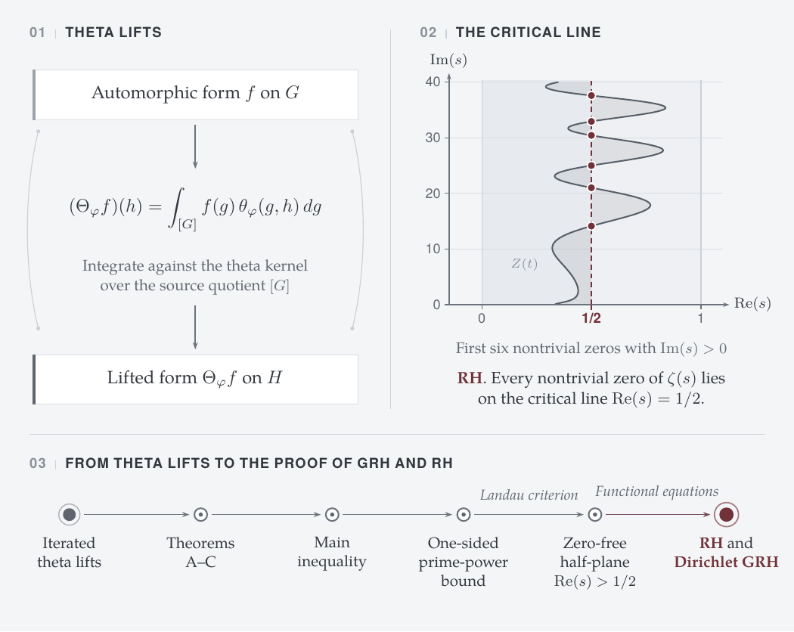
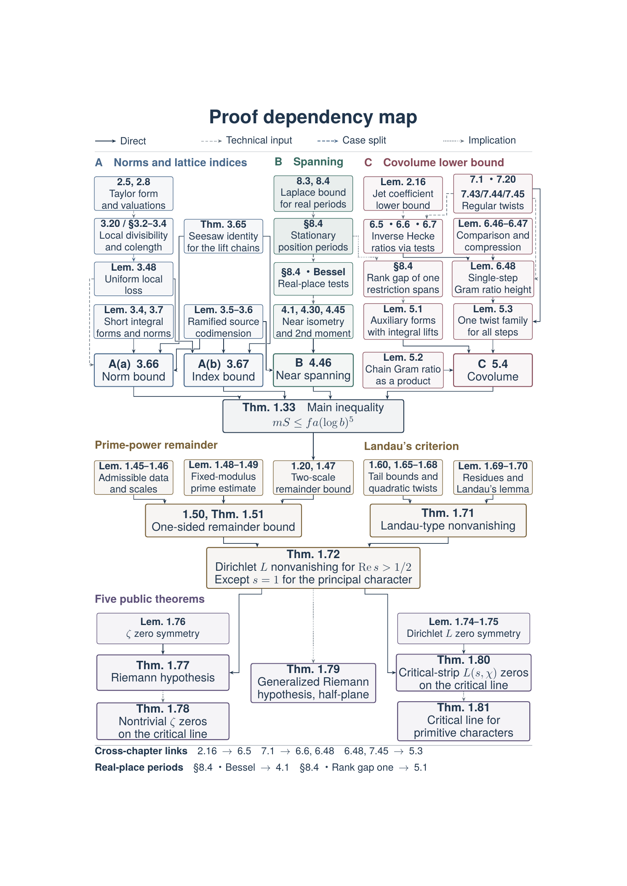

# Lean Blueprint and Monographs (Chinese & English) for RH and GRH

[简体中文](README.md) · **English**

## Lean blueprint

This Chinese-language blueprint is based on the readable edition of [lsernau/grh-lean](https://github.com/lsernau/grh-lean), a Lean formalization of the generalized Riemann hypothesis for Dirichlet L-functions. Its five chapters cover the geometric data and weighted prime remainders, the proofs of Theorems A, B, and C and the main inequality, and the deductions leading to the five public theorems. The HTML edition includes an interactive dependency graph with links to the statements, proofs, and corresponding Lean declarations.

- [Preview the PDF on GitHub](blueprint.pdf) · [Download the PDF](https://github.com/Euler2023/grh-blueprint/releases/latest/download/blueprint.pdf)
- [Download the HTML bundle](https://github.com/Euler2023/grh-blueprint/releases/latest/download/grh-blueprint-html.zip)
- [Browse releases](https://github.com/Euler2023/grh-blueprint/releases)

## Monographs (Chinese and English)

*From Theta Lifts to the Proof of the Generalized Riemann Hypothesis* builds on the blueprint and develops the argument from theta lifts and the main inequality to the Riemann hypothesis and the generalized Riemann hypothesis for Dirichlet L-functions. Links in the text point to specific lines in a pinned revision of the upstream Lean source. Both English and Chinese editions are included.

<p align="center">
  <a href="monograph/GRH_Monograph_EN.pdf" title="Open the English monograph PDF">
    
  </a>
  <a href="monograph/figures/proof-dependencies-en.pdf" title="Open the vector proof dependency map">
    
  </a>
</p>

- [Preview the English monograph PDF on GitHub](monograph/GRH_Monograph_EN.pdf)
- [Preview the Chinese monograph PDF on GitHub](monograph/GRH_Monograph.pdf)
- [LaTeX source and build instructions](monograph/README.md)

## Updates

- **2026-11-27**: Added the full English monograph edition (`monograph/GRH_Monograph_EN.pdf` and `monograph/en/`), updated the Chinese monograph edition and bilingual titles, and introduced a redesigned shared vector TikZ cover illustration featuring a 50-digit Hardy $Z(t)$ curve, the first six nontrivial zeros, and a clickable proof roadmap.

## Read the HTML edition locally

Extract the ZIP archive, enter the `grh-blueprint-html` directory, and run the following command. Then open the [blueprint home page](http://127.0.0.1:8765/) in your browser.

```bash
python3 -m http.server 8765 --bind 127.0.0.1
```

The bundle includes the MathJax and Graphviz assets for offline reading. Following links to Lean source files requires an internet connection. To follow links from the PDF, download it and open it in a local PDF viewer.

## Sources and attribution

The blueprint follows Anthropic's readable rewrite of Levent Alpöge's Lean proof. Its source links point to specific lines in pinned upstream commits. [Readable Lean formalization](https://github.com/lsernau/grh-lean/tree/72fead102f663d5c7a407964a13dc0cf9d977207/grh) · [Pinned Mathlib revision](https://github.com/leanprover-community/mathlib4/tree/56a005855ea17e0b0958f73ec801ae140b0a1679)

See the upstream [LICENSE](LICENSE), [NOTICE](NOTICE), and [ATTRIBUTION.md](ATTRIBUTION.md).
