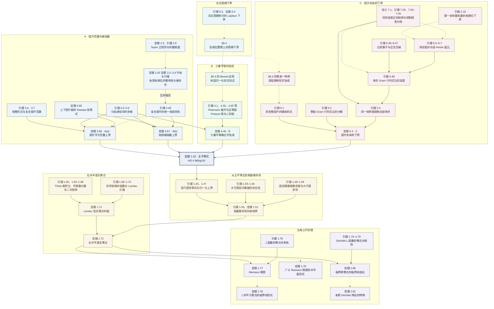

# 全书证明依赖图草案

箭头指向使用该结果的证明。实线表示直接依赖，灰色虚线表示技术输入，蓝色虚线表示互补情形汇合，点线表示推出或特化。

合并节点的证据按具体定理、引理或 Lean 声明记录。书内成图以蓝色编号和图下的跨章导航作为跳转入口。第 8 章的驻相周期、Bessel 测试和秩差一限制分别定位。

## 书内版式

前言之后、第 1 章之前安排一张竖版 A4 专页，沿用书内约 153 mm × 226 mm 的版心。图从上往下读。上部把 A、B 的分支放在左侧、C 的分支放在右侧，第 8 章的实位周期用两条线接入 B 和 C。中部以主不等式为汇合点。下部沿单侧界、Landau 判据和右半平面无零点下行，页底展开五条公开定理。每个框用结果编号和简短结论，印刷字号在排版时核对。

定理 1.72 同时使用定理 1.51 的单侧界和定理 1.71 的判据。第 7 章的正则性条件用于第 6 章的条件估计，正则族的存在性则在引理 5.3 中用来实际选取扭转。

完整的结果索引、逐边证据及分组说明见 [结果表](dependency-ledger.csv)、[边表](dependency-edges.csv) 和 [核对记录](dependency-audit.md)。
